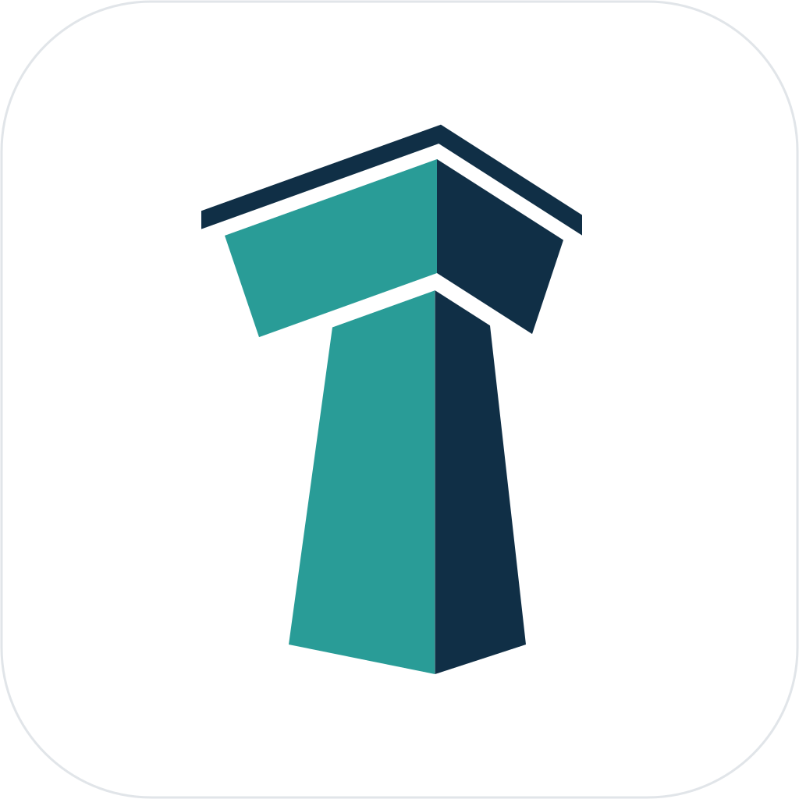

# tower



Tower manages and monitors agent sessions on one development server. It provides
shared terminal attachment, a local registry, scoped tokens, and live status events.
The pool and terminal parser are implemented in Rust, without libshpool or libghostty.

Managed launchers support Claude Code, Codex, Reasonix, Kimi Code, Grok Build,
opencode, Pi, Antigravity, and omp. Codex defaults to one host app-server shared by its sessions; terminal sessions can opt into native mode.
The public interface is Tower's JSON-RPC API; Miao clients need a Tower adapter.
Native Claude/Codex messages, approvals, process discovery, MCP, loopback HTTP/SSE,
and Allgather status/policy synchronization are available. Allgather supports owner-initiated pairing, incremental state and policy synchronization,
and managed sessions for Codex, Claude Code, and Antigravity. Image clipboard
sharing uses a separate opt-in provider connection.

## Development

The environment follows captain-miao's pinned Nix inputs and uses Rust **1.98.1**,
edition 2024. Linux uses Clang and mold; macOS uses Nix's default toolchain. The
flake provides x86_64/aarch64 Linux and Apple Silicon macOS environments. CI is
configured for Ubuntu and Apple Silicon macOS runners. CI checks the macOS
runner architecture. Intel macOS is outside the agreed platform contract.

```sh
# Enter the pinned development environment.
nix develop

# Alternatively, enable the shell's direnv hook and authorize this checkout.
direnv allow

cargo build --workspace --all-targets --locked
cargo run --bin tower-cli -- --help
```

The .envrc follows captain-miao's parent-environment convention, using direnv's
trust checks. An optional local .env stays out of version control. Nix's Git source
filter requires new source files to be added to Git before it sees them.

Outside Nix, rustup reads rust-toolchain.toml; a system C compiler is also needed.
The declared minimum Rust version matches the tested version. Earlier compilers
are not currently part of the support contract.

## Session ownership and protocol

Managed sessions have lifecycles controlled by tower. Unmanaged sessions are
registered and observed. The wire values remain `owned` and `registered`.
The separate `protocol` field identifies terminal, ACP, or another interaction
protocol. Management alone does not imply a PID, terminal attachment, or snapshots.

Backends supply session capabilities. The daemon uses those capabilities and the
selected backend for lifecycle operations. The terminal adapter owns pool startup,
PTY observations, attachment, and snapshots. The daemon can run without terminal
support; registry operations do not start the pool.

The default backend is `terminal`. Structured runtimes use `codex-app-server`
for Codex and `acp` for the Claude Code and Antigravity bridges. They have no
terminal attachment or snapshot. Unknown protocols return `unsupported`.
Unmanaged sessions can also carry protocol metadata:

```sh
./target/debug/tower-cli register --harness external-agent --protocol acp --cwd "$PWD"
./target/debug/tower-cli ls --protocol acp
```

## Session metadata and host metrics

Tags are shared session metadata. A `pinned` tag has no special lifecycle meaning:

```sh
tower-cli tags SESSION_ID --add pinned,review
tower-cli tags SESSION_ID --remove review
tower-cli attention clear SESSION_ID
tower-cli host metrics
```

Tower sets `needs_attention` when observed work becomes idle, input or approval is
needed, or a session is lost or exits unexpectedly. Starting work and explicit
acknowledgement clear it. Acknowledgement is an atomic update with no revision
argument. Repeated observations and daemon restart do not re-arm an acknowledged
transition. Tags and attention are available in `agent.get`, `agent.list`, local
events, and `tower-cli ls`. Metadata edits require local administrative authority.
These fields are not included in the existing Allgather status projection until
an extension is negotiated.

`host.metrics {}` takes no parameters. It returns a sample timestamp, CPU
utilization, used/total memory, and available space on the filesystem containing
the Tower user's home. Unavailable measurements are null; the first CPU sample
can be null until a second counter reading exists. Concurrent requests share a
short cache. Sampling does not block registry or session operations. Filesystem
browsing and directory completion remain the responsibility of the client or its
SSH transport; Tower does not expose `fs.*` methods.

## Repositories, checkouts, and worktrees

Allgather owns the project and repository catalog. Tower owns local checkout IDs,
directories, and working-copy observations. One repository can have several clones
and worktrees on a host. These features use the existing machine login and `/tower`
connection; they require no second credential. Tower pairs with one Allgather.
Install Git on the Tower host and make it available on `PATH`.

Register an existing working copy or bare repository, then use checkout IDs:

```sh
tower-cli checkout register "$PWD"
tower-cli checkout list
tower-cli vcs status CHECKOUT_ID
tower-cli launch codex --checkout CHECKOUT_ID
```

Registration discovers linked worktrees too. Bare storage is not a checkout; it
has no working directory or public checkout ID. IDs survive daemon restart and
verified worktree moves. A different working copy at an old path gets a different
ID. Sessions report an optional `checkout_id`; other managed protocols do not
need a filesystem checkout.

If a local remote matches exactly one catalog repository or an approved alias,
Tower associates it automatically. SSH usernames are part of remote identity.
Use `tower-cli checkout bind CHECKOUT_ID REPOSITORY_ID` to select a matching repository
explicitly, or `tower-cli checkout unbind CHECKOUT_ID` to keep it local. Repositories
without a published upstream URL can be bound explicitly. Binding does not clone
files or change Git configuration. `tower-cli catalog` shows the cached catalog and
whether it is current. An unavailable checkout can be removed from Tower metadata
with `tower-cli checkout forget CHECKOUT_ID`; this does not delete files.

VCS mutations use a reviewed plan followed by execution:

```sh
tower-cli vcs prepare CHECKOUT_ID checkout.create --options \
  '{"name":"feature","target":{"kind":"new_branch","branch":"feature"}}'
tower-cli vcs execute PLAN_ID
tower-cli vcs operation PLAN_ID

# Other operations use the same prepare/execute flow.
tower-cli vcs prepare CHECKOUT_ID checkout.move --options '{"name":"renamed"}'
tower-cli vcs prepare CHECKOUT_ID checkout.remove
tower-cli vcs prepare CHECKOUT_ID checkout.repair --options '{"name":"moved-externally"}'
tower-cli vcs prepare CHECKOUT_ID push
tower-cli vcs prepare CHECKOUT_ID pull

# Prepare a first working copy from bare storage.
tower-cli checkout register /path/to/repository.git --create \
  '{"name":"first","target":{"kind":"detached","revision":"HEAD"}}'
```

Creation also accepts `existing_branch` and `detached` targets. Push and pull
accept configured remote names and a `reference` in their options. Push never
forces an update; pull only fast-forwards. Plans expire after ten minutes and
recheck native identity, refs, configuration, policy, and session use before
mutation. Active sessions, including owned sessions with uncertain termination,
block moves, removal, and updates that affect their working directory. Removal
refuses dirty, untracked, ignored, locked, or main worktrees.

New and moved worktrees use a single directory name under a host-configured root:

```toml
[vcs]
worktree_root = "~/worktrees"
```

The default is `~/worktrees`. Native Git access uses the host's configured
credentials unless the caller supplies an SSH-agent context for that operation.
Tower does not obtain Git credentials from Allgather. Local read
credentials can inspect checkouts; registration, binding, and mutation require
local administrative authority. VCS methods accept checkout or plan IDs, never
an arbitrary working-directory path. Paths enter through explicit registration.

`vcs execute` replies when the operation completes or fails. A `completed`
receipt records native success. `result.refresh_pending` means checkout
observations may still be catching up. Repeating execution of the same plan
returns its retained receipt. Interrupted operations with uncertain effects
stay `unknown` and are not retried. They reserve the repository until an
administrator inspects Git state and any remaining processes, then runs
`tower-cli vcs release PLAN_ID --yes`. Release preserves the unknown outcome.

### Forwarded SSH agents

From an SSH connection with agent forwarding enabled:

```sh
tower-cli vcs prepare CHECKOUT_ID push --auth ssh-agent
tower-cli vcs execute PLAN_ID
```

The CLI reads its own `SSH_AUTH_SOCK`. Execute uses the prepared authentication
mode. Use a fresh forwarded connection for execution after reviewing the plan.
`--auth host` explicitly selects host authentication; preparation defaults to it.
Changing the authentication mode requires a new plan. Retrying a started or
finished operation returns its receipt without requiring the old agent.

Frontends can retain their persistent Tower RPC connection and use a separate,
temporary SSH connection to obtain and hold a forwarded agent socket. Negotiate
`vcs.ssh-agent.v1`, then send an `auth` field on `vcs.prepare` and `vcs.execute`:

```json
{"kind":"ssh_agent","socket":"/remote/private/agent.sock"}
```

Both push and pull preparation contact the remote. Close the forwarding
connection after preparation, and reopen one for execution. Keep it alive until
`vcs.operation` reports completion, failure, or uncertainty; the initial
`vcs.execute` response can be `running`. Forwarding loss does not prove a push
failed. Query the retained receipt instead of automatically retrying it.

Only authorized local UDS callers can supply a socket. Tower checks its owner,
privacy and identity, and rechecks it before network Git commands. The socket
path can be absolute or use the host-canonical `~/` form. The resolved socket
is kept in memory and applied only to that operation's network children; it is
not saved in plans or sent to Allgather. Plans expose only `review.authentication`.
Each execution supplies a fresh socket. HTTP requests cannot nominate one.
Agent-bound plans use a private storage format that older Tower binaries reject;
they cannot be downgraded into host-authenticated execution.

This follows normal SSH authentication behavior: host SSH configuration and
custom SSH commands still apply. It does not enforce agent-only authentication.
Tower never changes its process environment, and VCS children do not inherit
an incidental agent from the environment that started the daemon. Host-specific
agent settings can still be configured through OpenSSH. Existing local policy,
offline restrictions and checked VCS targets apply in either mode.

Allgather receives machine-scoped checkout observations, not Git contents or
credentials. Catalog and checkout updates use acknowledged deltas when smaller,
with full snapshots on reconnect. Renames update the existing checkout ID.
Offline, cached mappings and local inspection remain available. An enrolled
Tower requires a current connection, catalog, and policy for new VCS mutations.
Logout clears remote associations and preserves local checkout IDs and files.

## Managed terminal sessions

Install `tower`, `tower-cli`, and `tower-terminal-pool` together in one directory.
`tower` runs the server, `tower-cli` runs client commands, and
`tower-terminal-pool` hosts terminal sessions. Autostart resolves companions
beside the running executable; it does not search an agent’s `PATH` for them.
Install the desired agent CLIs on `PATH`:

```sh
./target/debug/tower-cli agents supported
./target/debug/tower-cli launch claude --cwd "$PWD"
./target/debug/tower-cli launch codex --cwd "$PWD"
./target/debug/tower-cli attach SESSION_ID
./target/debug/tower-cli snapshot SESSION_ID --json
./target/debug/tower-cli restart SESSION_ID
./target/debug/tower-cli kill SESSION_ID
./target/debug/tower-cli agents resumable
./target/debug/tower-cli agents conversations --harness claude
./target/debug/tower-cli launch claude --resume NATIVE_SESSION_ID
./target/debug/tower-cli launch codex --resume NATIVE_SESSION_ID --fork
./target/debug/tower-cli resume SESSION_ID
./target/debug/tower-cli events
```

Terminal sessions start immediately by default, including launches without an
attached terminal. Interactive `launch` also attaches; `--headless` suppresses that
automatic attach. Use `--defer` to reserve a session until an explicit attach.
Optional `--term TERM --rows ROWS --cols COLS` sets launch parameters. Otherwise
the pool uses the last successful attach's terminal type and dimensions, saved in
`terminal.json`, or `xterm-256color` and 80×24 before the first attach. A deferred
session uses its first attach for unspecified parameters. A running session keeps
its original `TERM`; connected clients still determine its current PTY size.
The JSON-RPC equivalent is `terminal: {term?, size?: {rows, cols}, defer?: false}`. Use `--` before arguments intended for the agent. Aliases include `claude`,
`kimi-code`, `grok-build`, `agy`, and `oh-my-pi`.

Press Ctrl-Space, then Ctrl-Q to detach. Kitty keyboard encodings are supported.
Several clients can attach and type; the PTY uses the smallest row and column
counts. A slow reader is disconnected when its output queue fills. Detach and
`tower-cli daemon stop` leave the agent running. `tower-cli daemon start` starts the server explicitly; `tower run` runs it in
the foreground. For manual cleanup, `tower-terminal-pool stop` stops the pool
and its sessions. Service managers can run it with `tower-terminal-pool run`.
The generated jobs are `tower` and `tower-terminal-pool` and have separate
lifetimes.

A running pool keeps its version when binaries are updated. Run
`tower-cli pool upgrade` to replace it; its sessions, including those launched
from Allgather, restart under the same IDs and resume their conversations. An
agent that was mid-turn is told to continue when PTY input is enabled for it
(`[inject.HARNESS] pty`, on by default for Claude Code). `--wait-idle` first waits until no terminal session is
mid-turn.
The server replaces a pool with a different protocol version automatically.

Snapshots contain reconstructed ANSI text, with a `truncated` flag for discarded
history and a `limited` flag for unsupported terminal behavior. The current bounds
are 10,000 history lines and 16 MiB of retained cells per session. The pool accepts
up to 64 sessions, 16 clients per session, and terminal sizes up to 512 columns by
256 rows. Stopped terminal buffers can be evicted when the pool fills; SQLite
retains ended-session metadata for 30 days by default. Clipboard writes (OSC 52
and kitty OSC 5522) reach attached terminals, so copying from a TUI sets every
attached client's clipboard. Clipboard reads are blocked. Reattach never replays
terminal strings. Output is forwarded as UTF-8 without C1 controls; invalid bytes
become U+FFFD.

Image clipboard access uses an opt-in provider connection. The provider runs on
the computer that owns the clipboard. For example, with a local Wayland desktop:

```sh
mkdir -p "$XDG_RUNTIME_DIR/tower-clipboard"
tower-cli clipboard provide --name desktop \
  --credentials "$XDG_RUNTIME_DIR/tower-clipboard/client.json" \
  -- wl-paste --type image/png
# In another terminal, while the provider is running:
tower-cli attach SESSION_ID --clipboard "$XDG_RUNTIME_DIR/tower-clipboard/client.json"
tower-cli clipboard status SESSION_ID
```

The reader command writes PNG bytes to stdout. `--format image/bmp` selects BMP;
a reader that offers both formats receives `TOWER_CLIPBOARD_FORMAT`. Stopping the
provider revokes its access. Credentials are private, connection-bound files.
A frontend can implement the same `clipboard.images.v1` protocol over a dedicated
UDS connection, including an SSH-forwarded socket. Tower does not manage SSH or
read the desktop clipboard itself.

Ctrl-V uses the provider bound to the client that sent the key. A separate
agent helper read uses the latest attached provider; detach selects the latest
remaining eligible attachment. An in-progress paste never switches providers.
Text paste remains ordinary terminal input. Image paste adds an attachment to
the composer and does not submit a prompt. Codex terminal sessions use a staged
file URL; Claude terminal sessions on Linux use image-only clipboard helpers.
Other backends reject clipboard attachment until they implement it.

For an SSH frontend, `session.attach_info` accepts `client_id` and `client_token`
and returns a one-use, 60-second ticket in `clipboard`. Pass that object to
`tower-cli attach SESSION_ID --clipboard-stdin`. On a PTY, wait for
`tower: ready for clipboard credential`, then write one JSON line. Tower disables
echo before this marker. Credentials and tickets must not appear in command
arguments. A provider credential object also works with this flag.

Images are limited to 16 MiB each. Private staging is bounded at 256 files and
256 MiB per host; files remain until the session ends or restarts so a composer
can read them later. Transfers expire after 30 seconds. A failed paste discards
that client's input queued behind it. If Claude helper consumption is uncertain,
restart the session before another image paste. A daemon restart revokes provider
bindings while terminal attachments keep running; reconnect the provider and
reattach to restore sharing. Clipboard bytes do not enter registry events,
SQLite, or Allgather sync. Allgather clipboard relay and desktop UI integration
are separate from this local/SSH interface.

Each launcher reports native session identity and status through a private socket.
Reports continue while the daemon is stopped. Status stays `unknown` until the
harness supplies evidence. Hook reports retain operational metadata, not prompt text.
Projects with an `.envrc` require direnv approval before their agents start.

Codex app-server mode requires version 0.166.0 or later and uses Codex's own
app-server daemon. This remains the default for terminal sessions and the only
mode for structured sessions. By default Tower connects to its socket,
`$CODEX_HOME/app-server-control/app-server-control.sock` (`~/.codex/...` when
`CODEX_HOME` is unset). If the daemon is not running, Tower runs
`codex app-server daemon start`; if that fails, the session's terminal explains
how to start it. Codex manages the daemon's lifecycle and updates.
Each session has a separate native thread and private execution environment.
The daemon survives Tower daemon and terminal restarts. Stopping a
session interrupts its turn, stops its background terminals, and waits for its
thread to unload. If termination cannot be confirmed, Tower reports uncertainty
and preserves the service and other sessions.

To run Codex directly in a terminal instead:

```sh
tower-cli launch codex --mode native
tower-cli launch codex --mode native --resume NATIVE_SESSION_ID
```

Native mode requires a Codex CLI with named profile and hook support. Tower
selects its own `tower` profile in the real `CODEX_HOME`; the base `config.toml`
and global hook settings are unchanged. Tower regenerates this profile's hook
definitions and Tower MCP entry. Codex's saved model choices, project trust,
other profile settings, and trust entries for hooks defined elsewhere survive
subsequent launches. An
existing unmarked `tower.config.toml` is refused. `--profile`/`-p` and `--remote`
remain reserved. Native sessions run in their own process group, and stopping
one does not stop the app-server or other sessions. Messaging uses `codex queue`
when supported; unsupported versions report the capability reason. Codex PTY
message injection remains disabled.

Restart/resume retains the selected mode. Use `restart SESSION_ID --mode native`
or `--mode app-server` to switch. Tower first checks that the destination store
can resolve the same native conversation; an unavailable conversation fails
before stopping the running session. Native mode does not use `codex.endpoint`.

To use another app-server, set its Unix endpoint once in Tower configuration.
Tower then connects only to that endpoint and never starts a server for it.
The endpoint cannot be overridden by session options or project configuration.

```toml
[codex]
endpoint = "unix:///path/to/private/codex.sock"

[history]
owned_retention_days = 30
```

Put these settings in `~/.config/tower/config.toml` (or `$XDG_CONFIG_HOME/tower/config.toml`).
Omit `codex.endpoint` to use the Codex daemon. The app-server must run with a
Bash or Zsh `SHELL`; when Tower starts the daemon it supplies Bash if needed. Approved project environment values and Tower MCP
credentials are stored in private per-session files; they are not placed in
native configuration values or applied to the shared server environment.
Per-launch model and permission options remain available through `launch -- …`.
Restart and resume keep the Tower ID. They require a native conversation ID.
Recovery after pool or host loss resumes previously active conversations; it
reports failure instead of starting a different conversation when the native ID
is missing. Kill disables automatic recovery. Manual resume information remains
until the retention period expires. Resume preserves supported runtime options
and does not replay initial prompts, fork requests, or worktree creation.
Restrictive tool and permission options are preserved. Unrecognized options stop
resume before the running agent is killed. Supply replacement options with
`restart SESSION_ID -- OPTIONS` or explicitly discard them with `--clear-args`.
The same options apply to `resume`.

`agents conversations` lists native histories, including conversations created
outside Tower. It does not register or start them. Use `--harness`, `--cwd-prefix`,
`--limit`, and `--refresh` to select results. Reads are bounded and cached briefly;
`truncated` and `errors` report incomplete inventories. Only metadata is returned.
Resume uses the conversation's recorded directory. An existing Tower identity is
returned in an `already_managed` error instead of creating a duplicate. A changed
native storage location after direnv loading prevents launch. Kimi and Antigravity
do not advertise fork support.

Tower preserves native history and credentials. Generated overlays are private.
Codex native mode uses a Tower-owned profile in its native home. Grok uses a Tower-owned hook
file in its native home; the hooks are inactive outside managed sessions.

## Try the local registry

After `cargo build --workspace --locked`, run:

```sh
./target/debug/tower-cli daemon status
./target/debug/tower-cli register --harness demo --session-id demo --cwd "$PWD"
./target/debug/tower-cli ls
./target/debug/tower-cli rules ls
./target/debug/tower-cli daemon stop
```

Registration prints a session ID and a private token. Set `TOWER_AGENT_ID` and
`TOWER_AGENT_TOKEN` to those values in the reporting process. It can then run
`tower-cli status --state working --seq 1`, `tower-cli heartbeat`, or `tower-cli unregister`.
Increase the sequence for each status update. Without a PID, send a heartbeat
at least once per minute. The daemon marks the session lost after three minutes
without a report. Registered sessions have weak trust; the token authenticates
subsequent reports. `tower-cli ls --all` also shows retained ended sessions.
Use `--shared-process` when several registered sessions share a process. Tower
will not infer a sender from that PID or signal the shared process to kill one session.

Commands start the daemon when needed. `--no-start` disables this behavior.
`tower run` runs in the foreground for a service manager. Automatic startup
uses an existing tower systemd or launchd job when present; otherwise it detaches.
Install independent daemon and pool jobs for persistent server operation:

```sh
tower-cli daemon install
# Linux: enable startup without an interactive login.
loginctl enable-linger "$USER"
```

Installation enables future user-session startup without stopping current agents.
On macOS, launchd jobs start at login. Use `--write-only` to generate service files
for manual setup. `tower-cli daemon uninstall` removes future startup configuration;
it does not stop current sessions. Detached fallback processes can still belong
to their caller's service-manager cgroup. Use the installed jobs on an SSH server.

The registry and execution journal share `tower.db` in `$XDG_STATE_HOME/tower`
(default `~/.local/state/tower`). Back up the private state directory with the
server stopped; retain `runtime/journal.id` and `runtime/fingerprint.key` with the
database. Existing two-database installations upgrade atomically at startup.
After a successful upgrade, `runtime/runtime.db` is an unused recovery copy;
Tower does not read it again or delete it automatically.

Use `--json` for structured output. `tower-cli rpc METHOD JSON` calls an implemented
method directly. Local runtime notes are in `workspace/docs/RUNTIME.md` when
available in the checkout.

## Messages and external sessions

```sh
tower-cli send SESSION_ID 'Review the failing test.'
printf '%s' 'Review the failing test.' | tower-cli send SESSION_ID --stdin
tower-cli approve APPROVAL_ID
tower-cli approve APPROVAL_ID --once
tower-cli approve APPROVAL_ID --deny
tower-cli approval status APPROVAL_ID
tower-cli approval watch APPROVAL_ID --timeout-s 600
tower-cli rules add --from 'harness:codex' --to 'cwd:~/work/project' --action allow
tower-cli hooks install claude
tower-cli hooks install codex --scope project
tower-cli mcp install claude
tower-cli mcp install codex
tower-cli run claude -- --model sonnet
tower-cli kill REGISTERED_ID --yes
```

Agents require approval for a new messaging relationship unless an allow rule
matches. After approval, resend the message. A remembered approval creates a
directional local allow rule; `--once` permits one resend of the same text.
Local approval cannot remove an Allgather requirement. Rules support `*` and `?`;
these match characters, including `/`. A `cwd:` selector without wildcards matches
that directory and its descendants. Wildcards do not grant administrative scopes.

Claude uses its authenticated inbox. Its receipt says `acknowledgement: transport`:
the socket write completed, but Claude provides no acceptance acknowledgement.
Claude's inbound policy can hold or refuse a message; Tower does not bypass it.
Codex uses its queue or the app-server channel. Managed app-server messages pass
through the TUI relay. Unknown submission outcomes are returned explicitly and
must not be retried automatically. PTY fallback is enabled for managed Claude sessions and can be enabled for other
harnesses with `[inject.HARNESS] pty = true`. It requires an idle supervisor check,
bracketed-paste support, and no pending or recent client input. A receipt says
`acknowledgement: pty_submission`; it does not assert harness acceptance. Native
harness state is observed asynchronously. Codex PTY fallback stays disabled because
its composer state cannot yet be established. Message bodies are limited to 32 KiB and are not
stored in Tower's database or logs. Native harness histories remain harness-owned.

Default rolling-minute limits are 6 messages per agent pair, 30 per human pair,
30 outgoing per sender, and 30 incoming per receiver. Pair limits count both
directions. Identical accepted text is suppressed for 10 seconds. Configure these
in `~/.config/tower/config.toml`:

```toml
[messaging]
pair_per_minute = 6
human_pair_per_minute = 30
outgoing_per_minute = 30
incoming_per_minute = 30

[scan]
enabled = true
interval_s = 10
```

The scanner skips managed-process ownership markers. Scan-only records cannot
receive messages until registration establishes a delivery channel. Installed
hooks report external Claude/Codex state. Codex requires native hook trust review.
`tower-cli run` uses the current terminal and registers the process without starting a
pool. Codex requires `tower-cli launch codex`, which uses the shared app-server.

`tower-cli mcp` serves the seven agent tools over stdio. Managed Claude/Codex sessions
receive its configuration automatically. External installations can be removed
with `tower-cli mcp uninstall HARNESS` and `tower-cli hooks uninstall HARNESS`.

## HTTP and event sinks

```toml
[http]
enabled = true
port = 7878
# Optional exact browser origins. Same-origin requests are accepted by default.
allowed_origins = []

[[event_sinks]]
kind = "webhook"
target = "http://127.0.0.1:9000/hook"
topics = ["approvals", "sessions"]
# token_env = "MY_WEBHOOK_TOKEN"

# Commands receive one metadata event as JSON on stdin; no shell is added.
# [[event_sinks]]
# kind = "command"
# target = "/path/to/event-handler"
# args = []
# topics = ["sessions"]
```

Restart the daemon after changing configuration. HTTP binds only to loopback.
Every `POST /rpc` and `GET /events` request requires an issued bearer token. Host
and Origin are checked. SSE authorization is rechecked while connected; revoking
the token closes the stream. Subscriptions support `agents`, `sessions`, `messages`,
`approvals`, and `sync`; reconnect and query current state after a dropped stream.
Event sinks exclude approval previews. They are transient, bounded, and do not
retry delivery. Webhooks require HTTPS except on loopback.

## Allgather

Create a pairing invitation in Allgather's private owner web app. Choose its
maximum scopes and optional node name, then use the short-lived code on the
machine that will run the agents:

```sh
tower-cli login https://allgather.example
```

Enter the code at the hidden prompt. You can also supply it as the second
argument when automation requires it: `tower-cli login URL "$PAIRING_CODE"`.

Use the private owner origin, not the public MCP/OAuth listener. The invitation
is the owner's consent; no second browser approval is needed. Control scopes
must be selected explicitly in the invitation and permitted by local configuration.
The CLI saves the machine credential before confirming receipt and prints a
private status URL containing no secrets. This also works over SSH. Use
`--name NAME` to suggest a name or `--read-only` to request only the read scope.

Tower saves each create request privately before sending it. If login is
interrupted, repeat the same command and options: Tower reuses its saved request
ID and body. A changed origin, host, scope selection, or name requires a new
invitation. The server always requires a code. Pairing and confirmation secrets
are removed from the saved attempt after confirmation; the machine credential
remains in the private state directory.

```sh
tower-cli rpc allgather.status
tower-cli logout
```

For automation, the owner first creates a pairing invitation in the private web
app, then supplies its code to the target machine. `--key-stdin` can import an
existing valid machine credential; Allgather no longer exposes a credential-mint
endpoint. Browser-account and CLI OAuth tokens are separate credentials.

Explicit configuration can restrict the scopes requested during enrollment:

```toml
[allgather]
scopes = ["read", "send", "acp:control"]
```

To allow Allgather to launch interactive agent terminals, add the literal
`terminal:control` scope, restart the Tower daemon, and pair again with an owner
invitation that permits it:

```toml
[allgather]
scopes = ["read", "send", "acp:control", "terminal:control"]
```

Select `mode=terminal` in Allgather's session launch operation. Tower starts the
named harness in an 80×24 terminal. Use `tower-cli attach TOWER_SESSION_ID` on
that host or over SSH to interact with it. Allgather can stop the whole runtime;
prompt, reply, configuration, and resume are unsupported for this mode. Codex
terminals use the configured shared app-server. No shell command, environment,
or per-session endpoint can be supplied through this launch interface.

Terminal launch requires both local configuration and invitation consent; `admin`,
`send`, and `acp:control` do not grant it. `[allgather] managed = false` disables
both remote launch modes. Terminal lifecycle events contain no PTY output or
transcript. A surviving pool session retains its identity across daemon restart;
after pool loss or upgrade, resumable terminal sessions recover their native
conversations under the same runtime identity. Recovery requires confirmed
termination and resumable history. Uncertain executions remain fenced.

Credentials are saved with mode 0600. Tower owns session state and local rules.
Allgather owns its policy table. Disconnecting or revoking the server-side key
retains Allgather mode and cached policy until local logout or re-enrollment.
Missing initial policy denies new session starts and messages. An accepted empty
policy removes only remote restrictions. Authorized local rule/token administration
remains available offline. Changed restart arguments require reconnection.

The baseline accepts remote health checks and messages, with configured scopes
and applicable policy. Remote policy changes use full snapshots or negotiated deltas. The connection
cannot administer Tower-local rules, tokens, or approvals. Managed execution uses
its own capability-negotiated interface and requires explicit `acp:control` consent;
an old generic `admin` scope does not grant it. New work requires a current control
connection and applied policy. Running turns may finish while disconnected.

Remote messages still require local approval or an allow rule. For example, an
administrator can permit Allgather messages to Codex sessions with:

```sh
tower-cli rules add --from allgather --to 'harness:codex' --action allow
```

Session synchronization sends changed fields and removals when both peers support
deltas. Reconnect and explicit resync use full snapshots. If a delta is larger
than a full snapshot, Tower sends the smaller snapshot. There is one unacknowledged
status update at a time. Frames are limited to 1 MiB and full projections to 5,000
records; oversized snapshots fail without truncation. Local rules and approvals
are not part of the status projection.

Managed commands have durable receipts and generation-bound execution owners.
Reconnection reads their status and does not repeat uncertain commands.
Structured sessions keep their identity across a Tower daemon restart, local or
launched from Allgather. Codex turns keep running in the Codex daemon. An ACP
agent is stopped and reloads its conversation when Tower starts again; a turn
it was running, or a Codex turn waiting for approval, is told to continue.
Pending approvals are withdrawn. If the continued turn needs approval, it
creates a new request. Transcript
events use a separate bounded journal and are released after acknowledgment.
Private permission requests, form requests, URL interactions, and replies remain
in memory. Explicit resume keeps the Tower session ID and creates a fresh execution
generation. Ordinary resume refuses an active or uncertain prior execution.
Use Allgather's `session resume --force` to stop and clean the exact old
executions before resuming. This requires `session-force-resume.v1` on both
sides. If ownership or termination cannot be confirmed, cleanup fails and no
replacement starts. Force resume preserves native history and never kills the
shared Codex host. Codex must have confirmed resumable history; ephemeral
threads are refused before cleanup. Terminal mode does not support explicit
remote resume.

Both sides must advertise `policy-sync.v1` and `session-status.v1`. Policy snapshots
atomically replace only the remote table; stale/conflicting revisions are rejected.
Allgather identifies a Tower record by `(machine_id, tower_id)`. The same opaque
Tower ID on another machine is permitted; IDs are never parsed for routing.
A rejected record remains locally usable with `sync_state: rejected`.
The status command reports redacted policy-application and connection errors.

In Allgather mode, starting, resuming, or controlling a session, and VCS
mutations, require a local `session` rule. Message rules do not apply to them:

```sh
tower-cli rules add --kind session --from allgather --to 'cwd:~/work' --action allow
```

Launch structured sessions from Allgather after permitting the relevant local
policy. Install the native CLI on the machine and configure its native login first.
Codex always uses app-server for this interface. Claude Code and Antigravity use
Tower's ACP bridges over their native streaming protocols.

| Harness | Permission replies | User questions | Cancellation |
| --- | --- | --- | --- |
| Codex | Yes | Forms and private URL consent | Current turn |
| Claude Code | Yes | Forms | Current turn |
| Antigravity | Native headless restrictions apply | Text prompts | Whole runtime |

The initial adapters accept text input. Unsupported image, audio, and resource
input fails explicitly. Codex configuration supports model, reasoning effort, and
`plan`/`default` collaboration mode. Each adapter reports its supported controls.
Native permissions remain in force. Stopping one runtime does not stop other sessions.

Optional journal limits use these defaults:

```toml
[runtime]
runtime_spool_bytes = 67108864
host_spool_bytes = 268435456
control_reserve_bytes = 1048576
receipt_count = 1000000
receipt_retention_days = 30
```

Receipts for active work remain available. Ended receipts compact after the retention
period; command identities and outcomes remain as enrollment-lifetime tombstones.
A full journal applies backpressure or reports a gap for output lost before sequence
assignment. It does not evict assigned, unacknowledged events.

With an adjacent Allgather checkout and its dependencies installed, use its pinned
environment to run the real integration checks against the local Tower build:

```sh
ALLGATHER_TEST_TOWER="$PWD/target/debug/tower-cli" nix develop ../allgather --no-write-lock-file -c bun --no-env-file ../allgather/scripts/verify-tower.ts
ALLGATHER_TEST_TOWER="$PWD/target/debug/tower-cli" nix develop ../allgather --no-write-lock-file -c bun --no-env-file ../allgather/scripts/verify-tower-managed.ts
```

## Checks

Run inside the development shell:

```sh
bash scripts/check-toolchain.sh
cargo fmt --all --check
cargo clippy --workspace --all-targets --locked -- -D warnings
cargo check -p tower-server --locked
cargo build --workspace --all-targets --locked
cargo test --workspace --locked
alejandra --check .
actionlint
shellcheck scripts/*.sh
bash -n .envrc
```

`nix flake check` also validates package builds, Clippy, Rust formatting, and a
daemon build with terminal support disabled.
The Linux CI lint job runs this check. The development shell places Cargo output
in the repository's `target/` directory, including when entered from a subdirectory.
`nix build` produces `tower`, `tower-cli`, and `tower-terminal-pool` in one
package; installation checks enforce the complete bundle. Nix uses `tower-cli`
as its default program. The server and pool run through their own entrypoints. When updating the compiler, keep flake.lock,
rust-toolchain.toml, and the workspace rust-version aligned. CI checks that the
Fenix and rustup pins agree.

Optional integration tests run the installed Codex CLI against a local Responses
fixture. They use isolated home directories and no API credentials. They test
shared app-server operation, real TTY attach, Kitty reattachment, simultaneous clients,
daemon restart, same-thread restart, and native message
delivery. The external app-server test verifies that approval requests reach the
existing TUI. The Claude inbox test checks that delivered text reaches the model:

```sh
cargo build --workspace --locked
cargo test -p tower@0.1.0 --test codex --locked -- --ignored
cargo test -p tower@0.1.0 --test claude --locked -- --ignored
```

The normal suite tests all nine adapters with local process fixtures. Node runs the
generated extension tests and is included in the Nix shell. The optional Claude
test uses a local fake Anthropic API and a synthetic test key. Claude Code and
Codex 0.166.0 have been verified on Linux. Full live-provider coverage for the
other harnesses is pending.

## Capture and replay tests

The optional Linux runner uses the separate Tracetape checkout through its public
library. The checkout must have its dependencies installed. It runs real Claude
and Codex tool calls, captures sanitized provider traffic, replays it in another
workspace, and rejects changed tool output. A response gate verifies `working`
status and daemon restart while the real agent waits for its next response.

```sh
nix develop
cargo build --workspace --bins --locked
TRACETAPE_ROOT=../tracetape bash scripts/test-e2e.sh
```

The runner uses fresh homes, synthetic keys, and a network namespace with only
loopback. It fails if isolation is unavailable. No real inference service is
contacted. Set `TOWER_TEST_ARTIFACT_DIR=workspace/e2e-traces` to retain sanitized
cassettes for inspection. The regular CI suite does not require installed coding
CLIs or the unpublished Tracetape checkout.

## Workspace

| Crate | Responsibility |
| --- | --- |
| `tower-protocol` | Public local API types; serde-only, published after the initial contract is ready |
| `tower-pal` | Platform terminal, IPC, process, and lifecycle operations |
| `tower-pool-proto` | Internal pool control and attach protocol |
| `tower-pool` | Terminal pool library, hosted by tower-terminal-pool |
| `tower-store` | Local persistence, backend bindings, policy snapshots, and synchronization state |
| `tower-sessions` | Managed backend contract and optional capability interfaces |
| `tower-terminal` | Terminal backend, launcher supervision, Codex relay, and attach client |
| `tower-agents` | Launchers, hooks, and resume adapters for nine harnesses |
| `tower-runtime` | Structured execution, native adapters, receipts, and transcript journal |
| `tower-server` | Registry, managed backends, authorization, rules, and events |
| `tower-clipboard` | Image provider, transfer broker, and native helper shims |
| `tower-vcs` | Checked Git/worktree discovery and operations |
| `tower` | Separate tower, tower-cli, and tower-terminal-pool executable entrypoints |

Publication is disabled during bootstrap. The tower workspace package and binary
name do not imply ownership of the existing crates.io name. Project code uses
MIT OR Apache-2.0; extracted upstream code must retain its copyright and licenses.
Harness integrations adapt portions of Captain Miao; see `LICENSE-CAPTAIN-MIAO`.
